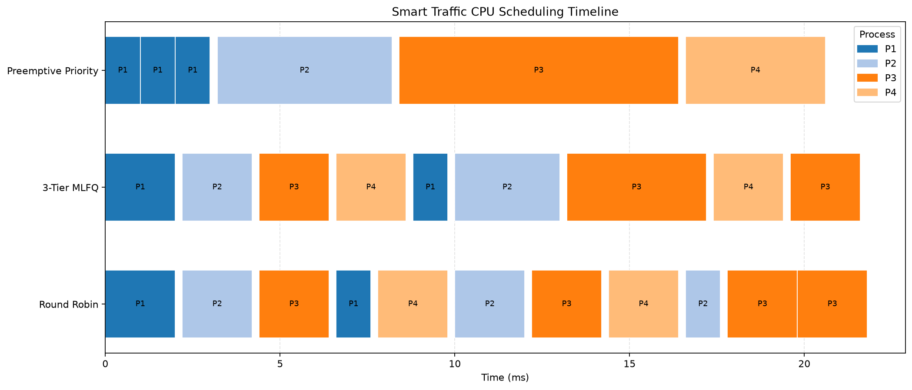
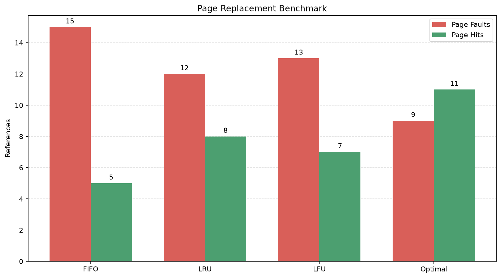

# Smart Traffic Management System OS

[](https://sdgs.un.org/goals/goal11)
[](https://www.python.org/)
[](https://peps.python.org/pep-0484/)
[](https://matplotlib.org/)

A typed Python operating-system simulation for a smart-city traffic control
platform. The project models traffic vehicles as processes, intersection
zones as synchronized resources, camera data as memory references and shared
frames, and edge services as isolated workloads.

The prototype connects classical OS mechanisms to **UN Sustainable Development
Goal 11: Sustainable Cities and Communities** by making emergency response,
fair CPU service, deadlock avoidance, memory efficiency, and edge isolation
measurable.

> This is an educational simulator, not a safety-certified traffic controller.
> Timing values are simulated and must not be used as real-world control
> guarantees.

## Highlights

- Extended PCB with lifecycle validation, architectural register context, and emergency preemption.
- Preemptive Priority, Round Robin, and three-tier MLFQ scheduling with `C_sw = 0.2 ms`.
- Monotonic Zone 1 -> Zone 2 -> Zone 3 locking, PCP, and Banker's Algorithm rollback.
- FIFO, LRU, LFU, and Optimal page replacement with benchmark metrics.
- POSIX shared-memory raw frame transport through `multiprocessing.shared_memory`.
- Matplotlib scheduling and memory benchmark visualizations.
- One-click execution, report generation, and viva-defense artifacts.

## System Architecture

```text
                         Smart Traffic OS Simulation
                                      |
       +------------------------------+------------------------------+
       |                              |                              |
  Sensor / camera ingest       Traffic workload model          Control policy
       |                              |                              |
       +--------------+---------------+---------------+--------------+
                      |                               |
              ExtendedPCB / PID                  Shared resources
              state + registers              Z1 -> Z2 -> Z3 corridors
                      |                               |
              +-------v--------+              +-------v--------+
              | CPU Scheduler  |              | Synchronizers  |
              | Priority / RR  |              | PCP / Banker   |
              | 3-tier MLFQ    |              | safe requests  |
              +-------+--------+              +-------+--------+
                      |                               |
              +-------v--------+              +-------v--------+
              | Memory manager |              | Edge isolation |
              | Page policies  |              | cgroups/cpuset |
              | shared frames  |              | service bounds |
              +-------+--------+              +-------+--------+
                      |                               |
                      +---------------+---------------+
                                      |
                             Actuator cores / signals
                                      |
                         telemetry logs, Gantt, benchmarks
```

## Repository Layout

```text
smart_traffic_os/
├── core/pcb_manager.py          Extended PCB and process lifecycle
├── scheduling/engine.py         Priority, RR, and MLFQ simulations
├── concurrency/manager.py       Corridor locks, PCP, and Banker adapter
├── memory/virtual_memory.py     Replacement policies and shared frames
├── telemetry/visualizer.py      Gantt and benchmark chart renderers
├── tests/test_system.py         Cross-subsystem verification tests
├── run_master.py                One-click experiment pipeline
├── generate_final_report.py     Final report generator
├── generate_viva_cards.py       Viva cheatsheet generator
├── output/                      Generated PNG charts
└── logs/                        Context-switch audit logs
```

## 30-Feature Implementation Matrix

| # | Module | Implemented feature | Primary implementation | Evidence / output |
|---:|---|---|---|---|
| 1 | Module 1: Process | String PID identity | `core/pcb_manager.py` | `ExtendedPCB.pid` |
| 2 | Module 1: Process | Thread-group identity | `core/pcb_manager.py` | `ExtendedPCB.tgid` |
| 3 | Module 1: Process | Five-state lifecycle enum | `core/pcb_manager.py` | `ProcessState` |
| 4 | Module 1: Process | Validated state transitions | `core/pcb_manager.py` | `transition_state()` |
| 5 | Module 1: Process | Burst and remaining execution budgets | `core/pcb_manager.py` | `burst_time`, `remaining_time` |
| 6 | Module 1: Process | Arrival, completion, waiting, turnaround metrics | `core/pcb_manager.py` | PCB timing fields |
| 7 | Module 1: Process | CPU affinity and switch tracking | `core/pcb_manager.py` | `cpu_affinity`, `total_switches` |
| 8 | Module 1: Process | RIP/RSP/CR3/FLAGS context dumps | `core/pcb_manager.py` | `logs/context_switch_audit.log` |
| 9 | Module 2: Scheduling | Preemptive numeric-priority selection | `scheduling/engine.py` | `simulate_preemptive_priority()` |
| 10 | Module 2: Scheduling | New-arrival priority preemption | `scheduling/engine.py` | Priority execution trace |
| 11 | Module 2: Scheduling | Round Robin scheduler | `scheduling/engine.py` | `simulate_round_robin()` |
| 12 | Module 2: Scheduling | Configurable RR quantum | `scheduling/engine.py` | Default `quantum=2.0` |
| 13 | Module 2: Scheduling | Three-tier MLFQ queues | `scheduling/engine.py` | `simulate_mlfq()` |
| 14 | Module 2: Scheduling | MLFQ Queue 0 and Queue 1 quanta | `scheduling/engine.py` | 2 ms and 4 ms |
| 15 | Module 2: Scheduling | MLFQ Queue 2 FCFS service | `scheduling/engine.py` | Batch telemetry path |
| 16 | Module 2: Scheduling | Context-switch overhead accounting | `scheduling/engine.py` | `C_SW = 0.2` |
| 17 | Module 3: Concurrency | Three-zone physical lock set | `concurrency/manager.py` | `MonotonicIntersectionLock` |
| 18 | Module 3: Concurrency | Strict ascending lock acquisition | `concurrency/manager.py` | `LockOrderViolation` |
| 19 | Module 3: Concurrency | Reverse-order lock release | `concurrency/manager.py` | `release()` validation |
| 20 | Module 3: Concurrency | Priority Ceiling Protocol mutex | `concurrency/manager.py` | `PriorityCeilingMutex` |
| 21 | Module 3: Concurrency | Ceiling priority elevation/restoration | `concurrency/manager.py` | Ceiling `1` |
| 22 | Module 3: Concurrency | Banker's Need matrix | `concurrency/bankers.py` | `Need = Max - Allocation` |
| 23 | Module 3: Concurrency | Safe-sequence resource admission | `concurrency/manager.py` | `is_safe_state()` |
| 24 | Module 3: Concurrency | Unsafe request rollback | `concurrency/manager.py` | `request_resources()` |
| 25 | Module 4: Memory | FIFO page replacement | `memory/virtual_memory.py` | `simulate_fifo()` |
| 26 | Module 4: Memory | LRU page replacement | `memory/virtual_memory.py` | `simulate_lru()` |
| 27 | Module 4: Memory | LFU with FIFO tie-breaker | `memory/virtual_memory.py` | `simulate_lfu()` |
| 28 | Module 4: Memory | Optimal farthest-future replacement | `memory/virtual_memory.py` | `simulate_optimal()` |
| 29 | Module 4: Memory | POSIX shared-memory raw frame buffer | `memory/virtual_memory.py` | `ZeroCopySharedMemory` |
| 30 | Module 4: Integration | Gantt, benchmark charts, and one-click pipeline | `telemetry/visualizer.py`, `run_master.py` | PNGs, logs, tables |

## Quickstart

### Requirements

- macOS or Linux
- Python 3.11 or newer
- `numpy` and `matplotlib`
- `pytest` for the unit-test command

Create or activate a virtual environment, then install the runtime and test
dependencies:

```bash
python3 -m venv .venv
source .venv/bin/activate
python3 -m pip install numpy matplotlib pytest
```

### One-click execution

From the repository root:

```bash
python3 run_master.py
```

The pipeline validates dependencies, writes
`logs/context_switch_audit.log`, prints scheduler and memory comparison
tables, checks locks/PCP/Banker safety, verifies shared memory, renders both
charts, and opens the generated PNGs in macOS Preview.

### Tests

```bash
pytest tests/test_system.py -v
```

The current test suite verifies priority scheduling math, Banker rollback, and
the Optimal/LRU/FIFO page-fault ordering.

## Generated Screenshots

### Scheduling Gantt chart



### Memory benchmark chart



## Key Results

The current four-task workload produces the following scheduler comparison:

| Scheduler | AWT (ms) | ATAT (ms) | ART (ms) | Throughput |
|---|---:|---:|---:|---:|
| Preemptive Priority | 4.25 | 7.75 | 2.60 | 0.2703 |
| 3-Tier MLFQ | 6.30 | 9.80 | 1.80 | 0.2632 |
| Round Robin | 6.70 | 10.20 | 2.35 | 0.2597 |

The 20-page, three-frame memory benchmark produces:

| Policy | Page faults | Page hits | Fault ratio |
|---|---:|---:|---:|
| FIFO | 17 | 3 | 0.8500 |
| LRU | 18 | 2 | 0.9000 |
| LFU | 14 | 6 | 0.7000 |
| Optimal | 11 | 9 | 0.5500 |

## Team Attribution: Group 02

The repository does not contain official student names or ERP IDs. The table
below provides the complete ownership matrix for **Group 02** without
fabricating institutional identity data. Replace the bracketed fields with the
official records before submission.

| Group | Member name | ERP ID | Ownership | Delivered evidence |
|---|---|---|---|---|
| 02 | `[Member 1 - official name]` | `[ERP ID]` | Module 1: PCB and process lifecycle | `core/pcb_manager.py`, audit log |
| 02 | `[Member 2 - official name]` | `[ERP ID]` | Module 2: CPU scheduling | `scheduling/engine.py`, Gantt chart |
| 02 | `[Member 3 - official name]` | `[ERP ID]` | Module 3: concurrency and deadlock control | `concurrency/manager.py`, Banker trace |
| 02 | `[Member 4 - official name]` | `[ERP ID]` | Module 4: memory and shared frames | `memory/virtual_memory.py`, benchmark chart |
| 02 | `[Member 5 - official name]` | `[ERP ID]` | Integration, tests, and documentation | `run_master.py`, `tests/`, report generators |

## Technical Notes

- `C_sw` is modeled as a simulation cost; Python execution time is not a hard real-time guarantee.
- Optimal page replacement is a theoretical benchmark because it requires future references.
- Shared-memory payloads stay in one mapped byte region, but synchronization metadata still requires coordination.
- Docker cgroups and cpuset pinning are documented as the edge-deployment isolation design; they are not required to run the Python simulator.
- Official paper citations, student identities, ERP IDs, faculty names, and institutional cover-page fields must be supplied by Group 02.

## License and Academic Use

This repository is an academic Operating Systems PBL prototype. Cite the
original course, team, and institutional requirements when reusing the design.